# langgraph-hitl-incident-graph

**Un agente que responde a incidencias de producción como un SRE de guardia que necesita el visto bueno de un compañero: investiga métricas y logs por su cuenta, propone una única acción concreta y no toca nada hasta que una persona la aprueba. Si la propuesta se sale de la política, ni siquiera llega a preguntar.**


Le dices *«Checkout is failing with 502 errors since this morning deploy»* y esto es lo que ocurre:

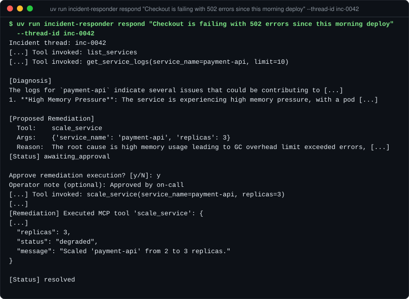

Nadie le dice al modelo qué servicio mirar ni qué herramienta usar: decide él listar los servicios, leer los logs de `payment-api` y proponer `scale_service` con 3 réplicas. Lo que sí está fijado en el grafo es el orden de seguridad: el agente que investiga solo tiene herramientas de lectura, y la de escritura se ejecuta después de la respuesta del operador, nunca antes.

## Qué demuestra este proyecto

| Capacidad | Cómo está resuelta | Dónde |
|---|---|---|
| **Orquestación multiagente** | `StateGraph` con un nodo `supervisor` que enruta a `diagnose_agent` (bucle de herramientas) o a `remediation_planner` según el estado del incidente | [`supervisor.py`](src/incident_responder/supervisor.py) |
| **Human-in-the-Loop** | `interrupt()` en `human_approval` y reanudación con `Command(resume={"approved": …, "note": …})`, también desde otro proceso | [`supervisor.py`](src/incident_responder/supervisor.py), [`cli.py`](src/incident_responder/cli.py) |
| **Servidor MCP propio** | `MCPServer` por stdio con 3 herramientas de lectura y 3 de escritura; el cliente las descubre con `list_tools()` y las convierte en `StructuredTool` | [`mcp_server.py`](src/incident_responder/mcp_server.py), [`mcp_tools.py`](src/incident_responder/mcp_tools.py) |
| **Mínimo privilegio** | `load_mcp_tool_groups` separa lectura y escritura: el LLM solo recibe las de lectura con `bind_tools`; la de escritura la invoca el nodo ejecutor | [`mcp_tools.py`](src/incident_responder/mcp_tools.py), [`supervisor.py`](src/incident_responder/supervisor.py) |
| **Salida estructurada** | El planificador devuelve un `RemediationProposal` de Pydantic con `tool` limitado a un `Literal` de tres acciones | [`supervisor.py`](src/incident_responder/supervisor.py) |
| **Guardrails deterministas** | `ActionGuardrails` comprueba servicios y herramientas permitidos, réplicas entre 1 y 10, *cooldown* y máximo de acciones por hilo; se evalúa antes de pedir aprobación y otra vez antes de ejecutar | [`guardrails.py`](src/incident_responder/guardrails.py) |
| **Estado persistente** | `IncidentState` con el *reducer* `add_messages` y `AsyncSqliteSaver`: el incidente pausado sobrevive al cierre del proceso | [`state.py`](src/incident_responder/state.py) |
| **Auditoría** | `AuditLogger` escribe cada transición (`PROPOSED`, `APPROVED`, `REJECTED`, `GUARDRAIL_BLOCKED`, `EXECUTED`, `EXECUTION_FAILED`) en JSON Lines | [`guardrails.py`](src/incident_responder/guardrails.py) |
| **Tests sin depender del LLM** | 24 tests; el supervisor se prueba con modelos simulados y contra el servidor MCP real arrancado por stdio | [`tests/`](tests/) |

Todo corre en local con un modelo de 4,7 GB (`qwen2.5:7b`) servido por Ollama: no hace falta clave de API ni cuenta en ningún servicio. Los tests ni siquiera necesitan Ollama.

## Arquitectura

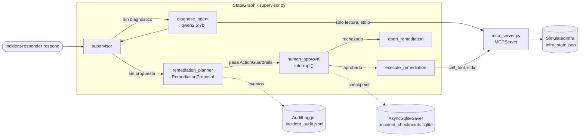

El núcleo es el tramo `remediation_planner → human_approval → execute_remediation`. La decisión de diseño que lo sostiene es que **el modelo nunca tiene en la mano una herramienta de escritura**: `diagnose_agent` se construye con `bind_tools(read_tools)` y, si pidiera otra, recibe `Read tool '…' is not permitted`. La escritura la lanza `execute_remediation` con los argumentos ya validados y aprobados, así que un error del modelo se queda en una propuesta mala que una persona puede rechazar.

## Puesta en marcha

### Requisitos

- **[uv](https://docs.astral.sh/uv/)**; el proyecto fija Python 3.11 en `.python-version`
- **[Ollama](https://ollama.com/download)** instalado y en ejecución (solo para la CLI; los tests no lo usan)
- Unos **5 GB de disco** para `qwen2.5:7b`

### Instalación

```bash
git clone https://github.com/femogo/langgraph-hitl-incident-graph.git
cd langgraph-hitl-incident-graph

ollama pull qwen2.5:7b

uv sync
uv run pytest -q
```

Si todo está bien verás esto:

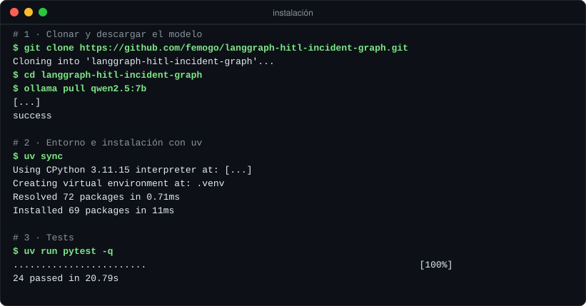

> [!IMPORTANT]
> - La CLI guarda tres ficheros **en la carpeta desde la que la lanzas**: `.infra_state.json` (la infraestructura simulada), `.incident_checkpoints.sqlite` (los incidentes pausados) y `.incident_audit.jsonl`. Lanza `respond` y `resume` desde la misma carpeta o `resume` no encontrará el incidente.
> - La infraestructura simulada **conserva los cambios** entre ejecuciones: después de escalar `payment-api`, el siguiente incidente ya no la encuentra igual. Para volver al estado inicial, `rm -f .infra_state.json`.
> - No hace falta copiar `.env.example`: los valores por defecto de `config.py` son los mismos. Crea un `.env` solo si quieres otro modelo (`OLLAMA_MODEL`) u otra URL de Ollama (`OLLAMA_BASE_URL`).

## Recorrido paso a paso

Todo se maneja con un único comando, `incident-responder`, que tiene cuatro subcomandos: `respond`, `resume`, `status` y `audit`. El recorrido sigue varios incidentes: uno aprobado al momento, otro pausado y aprobado desde otro proceso, uno rechazado y otro bloqueado por la política. Por eso los pasos 3 a 5 empiezan borrando `.infra_state.json`: así todos parten de la misma infraestructura.

Las capturas son salidas reales, recortadas donde aparece `[...]`. Las líneas `Tool invoked` son el log del servidor MCP, que escribe en *stderr*. Cada incidente tardó unos 25 segundos en la máquina de las capturas, y el texto del modelo cambia entre ejecuciones.

### Paso 1 · La infraestructura simulada

```bash
uv run incident-responder status
```

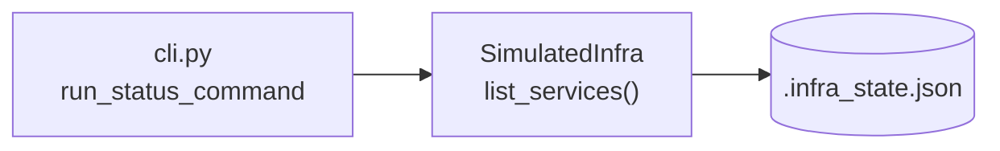

Tres servicios con métricas y logs inventados pero coherentes. `payment-api` arranca degradado: 1850 ms de latencia, memoria al 94,2 % y un log que dice `GC overhead limit exceeded following deployment v2.3.1`. Es el incidente que el agente tiene que encontrar.

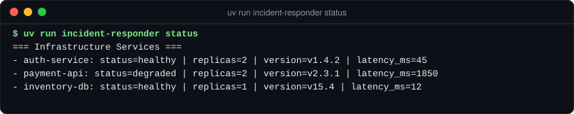

> Los servicios, sus métricas y sus logs viven en un JSON local (`SimulatedInfra`). Las acciones de remediación cambian ese fichero con reglas fijas; no hay ningún sistema real detrás.

### Paso 2 · Diagnóstico, propuesta y aprobación en la terminal

```bash
uv run incident-responder respond "Checkout is failing with 502 errors since this morning deploy" --thread-id inc-0042
```

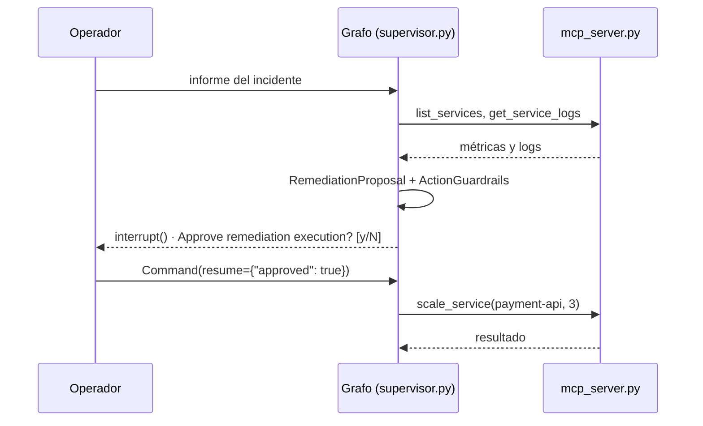

El grafo corre hasta `interrupt()` y la CLI pregunta en la propia terminal; respondiendo `y` se reanuda y ejecuta. La salida es la captura que abre este README.

Fíjate en el final: el incidente pasa a `resolved`, pero el servicio sigue `"status": "degraded"`. `resolved` significa que la acción aprobada se ejecutó, no que el problema esté arreglado. Además, el log apunta al despliegue v2.3.1, que pediría un `rollback_deployment`, y aun así el modelo eligió escalar en las 9 ejecuciones de prueba sobre `payment-api` que no pedían una acción concreta. Es justo el tipo de decisión que la aprobación humana está para corregir.

### Paso 3 · Pausar ahora y aprobar desde otro proceso

```bash
rm -f .infra_state.json
uv run incident-responder respond "payment-api latency went above 1.8s after the v2.3.1 release" --thread-id inc-0043 --non-interactive
uv run incident-responder status --thread-id inc-0043
uv run incident-responder resume --thread-id inc-0043 --approve --note "Approved by on-call"
```

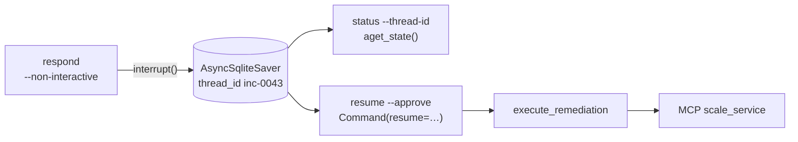

Con `--non-interactive` el proceso no pregunta: deja el checkpoint en SQLite, imprime cómo reanudar y termina con código de salida 2, pensado para que lo lance un script o una alerta. La aprobación llega después, en otro proceso.

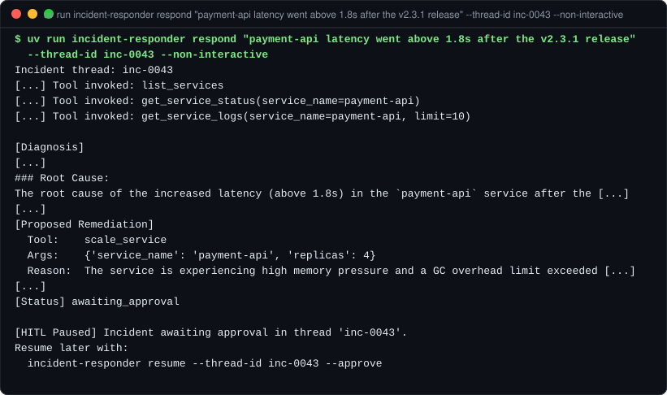

`status --thread-id` lee el checkpoint sin reanudarlo. Fíjate en `Pending next node: ['human_approval']`: LangGraph sabe en qué nodo se quedó el grafo.

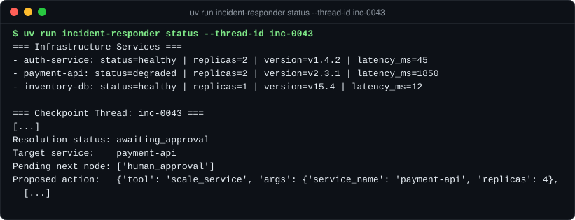

`resume` vuelve a abrir el servidor MCP y la base de checkpoints, reconstruye el grafo y lo reanuda con la decisión. No repite el diagnóstico ni vuelve a llamar al modelo: va directo a `scale_service`.

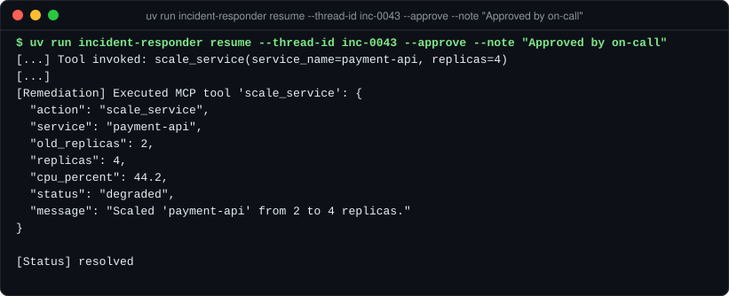

### Paso 4 · El operador rechaza

```bash
rm -f .infra_state.json
uv run incident-responder respond "auth-service users report slow logins" --thread-id inc-0044 --reject --note "Not during peak hours"
```

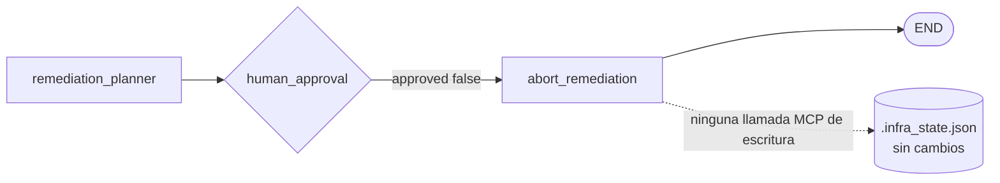

`--reject` responde «no» en la puerta de aprobación sin preguntar. Fíjate en la propuesta: el diagnóstico concluye que `auth-service` está sano, y el planificador propone escalar **otro servicio**, `payment-api`, con una justificación especulativa. Pasó igual al repetirlo: es una propuesta mala de un modelo de 7B, y el rechazo la cierra con `Infrastructure left untouched`.

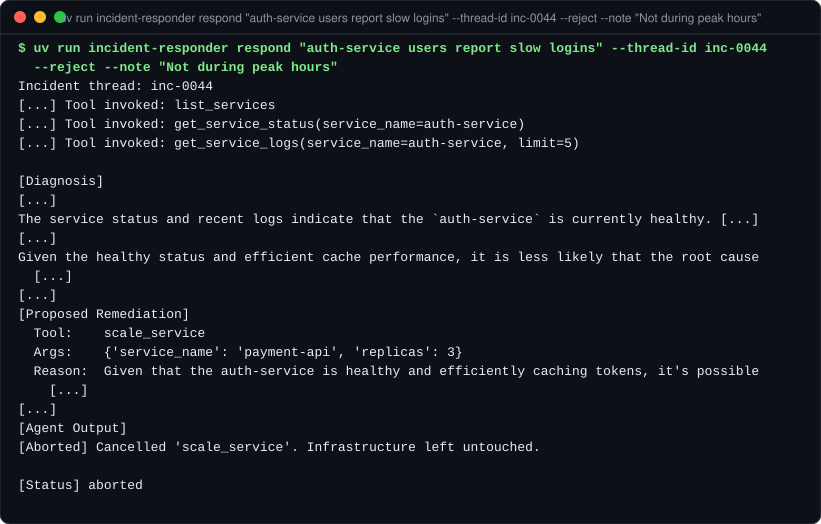

### Paso 5 · La política bloquea antes de molestar al operador

```bash
rm -f .infra_state.json
uv run incident-responder respond "Black Friday traffic: payment-api is overloaded, scale it to 20 replicas now" --thread-id inc-0045 --approve
```

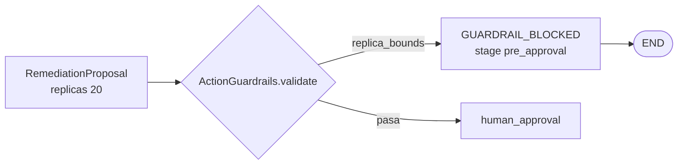

El informe pide 20 réplicas y el modelo obedece. `ActionGuardrails` lo para antes del `interrupt()`: aunque el comando lleve `--approve`, la aprobación ni siquiera se pide. La regla es código, no una instrucción en el *prompt*, así que el modelo no se la puede saltar.

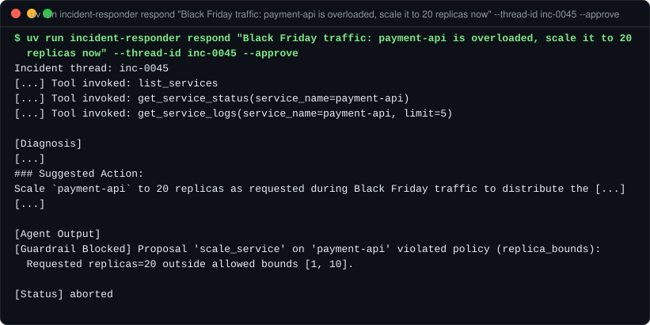

> El *cooldown* y el máximo de acciones por hilo se guardan en memoria dentro de cada `ActionGuardrails`. La CLI crea uno nuevo en cada invocación, así que esas dos reglas solo actúan dentro de un mismo proceso (los tests las comprueban así). Las listas de servicios y herramientas permitidos y el rango de réplicas se aplican siempre.

### Paso 6 · Rastro de auditoría

```bash
uv run incident-responder audit
```

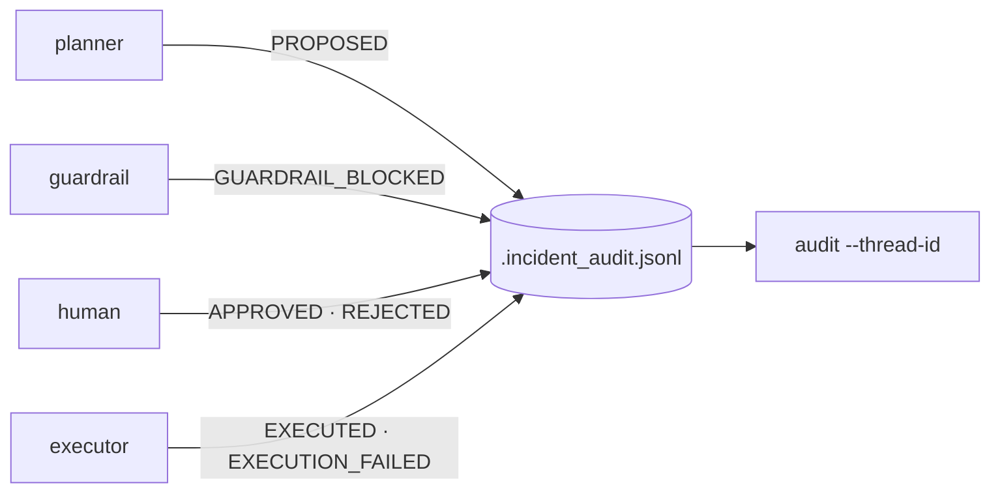

Cada transición queda en una línea JSON con quién la hizo (`actor`), en qué incidente y con qué argumentos. En la captura están los incidentes de los pasos 3 a 5: aprobado y ejecutado, rechazado con su nota, y bloqueado con la regla que saltó y en qué fase (`pre_approval`).

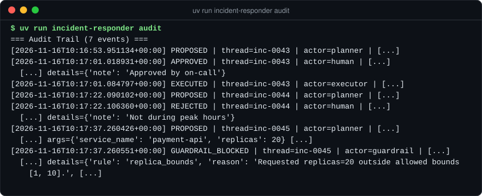

En tu carpeta verás más eventos: los del paso 2 (`inc-0042`) y los de `mcp-approve-thread` y `mcp-reject-thread`, que deja `pytest` porque dos tests de `test_supervisor_mcp.py` usan la ruta de auditoría por defecto. Para ver un solo incidente: `uv run incident-responder audit --thread-id inc-0045`.

**Inspector MCP (opcional).** El servidor funciona solo, con cualquier cliente MCP. Para listar sus herramientas con el inspector oficial:

```bash
npx @modelcontextprotocol/inspector --cli uv run python -m incident_responder.mcp_server --method tools/list
```

## Tests

```bash
uv run pytest -v
uv run ruff check .
```

| Fichero | Qué comprueba |
|---|---|
| `test_smoke.py` | Versión del paquete y que `Settings` lee las variables de entorno |
| `test_mcp_server.py` | Ciclo de vida de `SimulatedInfra`, ida y vuelta por stdio con el servidor MCP real y error ante un servicio desconocido |
| `test_state_checkpoint.py` | El *reducer* acumula mensajes, el checkpoint SQLite sobrevive a reabrir la base y los hilos no se mezclan |
| `test_hitl_approval.py` | El grafo se pausa antes de tocar la infraestructura; aprobar en una instancia nueva del grafo ejecuta el *rollback*; rechazar no cambia nada |
| `test_supervisor_mcp.py` | La sesión MCP separa 3 herramientas de lectura y 3 de escritura; el supervisor diagnostica, se pausa, ejecuta al aprobar y no muta nada al rechazar |
| `test_guardrails_audit.py` | Cada regla de la política (servicios y herramientas permitidos, réplicas, *cooldown*, límite por hilo), bloqueo antes del HITL, eventos de auditoría y bloqueo en ejecución si salta el *cooldown* mientras el incidente esperaba |
| `test_cli.py` | Los cuatro subcomandos: aprobar y rechazar en interactivo, pausar y reanudar en dos invocaciones, guardrail, `status`, `audit` y `resume` de un incidente inexistente |

Ningún test llama a un LLM real: los del supervisor y la CLI usan modelos simulados (`GenericFakeChatModel` o un `BaseChatModel` con respuestas fijas) y los de `graph.py` no usan modelo. Resultado: `24 passed` y `All checks passed!` en `ruff`.

## Estructura

```
src/incident_responder/
  cli.py            CLI incident-responder: respond, resume, status, audit
  supervisor.py     Grafo supervisor: diagnóstico, planificador, HITL y ejecución por MCP
  mcp_server.py     Servidor MCP (stdio) con 3 herramientas de lectura y 3 de escritura
  mcp_tools.py      Cliente MCP: descubre las herramientas y las separa en lectura y escritura
  guardrails.py     GuardrailPolicy, ActionGuardrails y AuditLogger
  infra.py          SimulatedInfra: servicios, métricas y logs en un JSON
  state.py          IncidentState y checkpointers SQLite (síncrono y asíncrono)
  graph.py          Grafo HITL del hito 3, con reglas fijas en lugar de LLM (lo usan los tests)
  config.py         Settings con pydantic-settings (.env)
tests/              Un fichero de tests por hito
docs/adr/           Decisión de arquitectura: supervisor, MCP por stdio, SQLite
PROGRESS.md         Registro de hitos
```

## Problemas frecuentes

| Síntoma | Causa y solución |
|---|---|
| `httpx.ConnectError: All connection attempts failed` | Ollama no está arrancado. Ábrelo o ejecuta `ollama serve` |
| `ollama._types.ResponseError: model 'qwen2.5:7b' not found (status code: 404)` | Falta `ollama pull qwen2.5:7b`, o el `OLLAMA_MODEL` de tu `.env` no está descargado |
| `Error: No checkpoint found for thread_id='…'.` | Ese `--thread-id` no está en el `.incident_checkpoints.sqlite` de esta carpeta. Lanza `resume` desde donde lanzaste `respond` |
| `Error: Thread '…' is not paused at an interrupt (status=resolved).` | Ese incidente ya se aprobó o se rechazó; no queda nada que reanudar |
| `payment-api` ya no sale degradado y el agente no encuentra el problema | Un incidente anterior cambió la infraestructura simulada. `rm -f .infra_state.json` para empezar de cero |
| Al redirigir la salida a un fichero, todos los `Tool invoked` salen antes del diagnóstico | La salida estándar va con búfer y el log del servidor MCP no. Lanza con `PYTHONUNBUFFERED=1` para verlos en orden |

## Sobre el proyecto

Prototipo construido en siete hitos (del 0 al 6), cada uno con su commit y sus tests: esqueleto y ADR, infraestructura simulada y servidor MCP, estado con checkpoints, HITL, supervisor con Ollama, guardrails con auditoría y CLI. El registro de cada hito está en [`PROGRESS.md`](PROGRESS.md), y las decisiones de arquitectura, con las alternativas descartadas, en [`docs/adr/0001-architecture-and-mcp-transport.md`](docs/adr/0001-architecture-and-mcp-transport.md). La ADR lo plantea para Windows 11; las capturas de este README se tomaron en Linux.

**Autor:** Fernando Morales · [femogo.github.io](https://femogo.github.io) · [GitHub](https://github.com/femogo)
